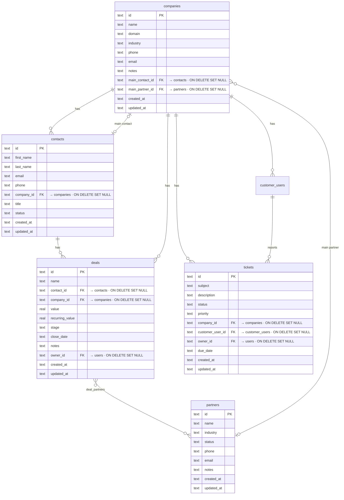

# OpenCRM: The Open-Source HubSpot Alternative for SaaS

A lightweight CRM with contacts, companies, partners, customer users, tickets and deals — built for SaaS teams and AI agents. It runs on your own Cloudflare account: a Go API in a Cloudflare Container, with its data in D1.

Built with **React + Tailwind + shadcn/ui** on **Go + Cloudflare Containers + D1**. Path-based routing, UUID keys, its own accounts and API tokens, and a dual-mode UI: one for humans and one for AI agents (larger targets, always-visible actions).

## What Is It?

OpenCRM is a production-ready contact relationship manager. Think of it as an open-source HubSpot alternative — a CRM you can self-host and customize.

Unlike HubSpot or Salesforce, it runs on your own Cloudflare account, with no API keys for other services and no per-seat pricing. It provides a complete sales pipeline and lead management system. Manage contacts, companies, and deals with rich column types, inline editing, and full CRUD — all out of the box.

## Features

- **Six entities** — contacts, companies, partners, customer users, tickets and deals with foreign-key relationships (UUID keys, not enumerable ids). Partners are the firms that work deals with you (resellers, referrers), kept apart from the companies you sell to; a deal has any number of them. Customer users are the people who use your product at each customer, kept apart from contacts. Tickets are a customer's requests and problems: each is for a customer, may name the customer user who reported it, and has a status (open, in progress, waiting, resolved, closed), a priority, an owner and a due date. A company can name a contact as its main contact, its own or another company's (a building's property manager works at the management firm), and a partner as its main partner: the company, its main contact and its main partner are who the customer is. A company's Team tab lists its contacts and the partners of its deals, with a star on the main contact and the main partner; a deal can name one of its partners as its main partner
- **Accounts and API tokens** — people sign in with an email and a password; an admin adds them in Settings → Users, and everyone can make personal API tokens for agents and scripts in Settings → API tokens (see [Accounts and API tokens](#accounts-and-api-tokens))
- **Activity timeline** — every contact/company/deal has a feed; notes, deal updates (a call, a message, an email, a meeting), and deals won or lost all log to it
- **CSV / XLSX import** — upload a spreadsheet, map columns to fields (exact-match auto-mapping), preview, import; company names resolve to existing companies or are created
- **Deal pipeline** — a board tracking deals through stages (prospect → qualified → proposal → negotiation → won/lost) with per-column totals
- **Next steps** (Deals → Next steps): every open deal shows its next step (its soonest task with a date, ours or theirs), and the open deals are listed worst first with the reasons in plain words: our promise overdue, no next step, waiting on them, the close date passed. The deal page shows its next step, its tasks and its activity. The CRM doesn't read email or calendars, so what happens outside it (a phone call, an email, a WhatsApp message, a meeting) is logged with `POST /api/deals/{id}/updates`, usually by an agent you told about it, and counts as contact
- **Customers** — the Customers page shows every customer worst first with the reasons in plain words (an overdue promise, waiting on them, a renewal coming up) and the few things to do first. A company becomes a customer from the close date of its first won deal, or by hand. It only calls an account on track through what it can see: since it reads no email or calendar, an account with nothing against it and no update logged lately shows "Can't tell" rather than "On track"
- **Path routing** — deep-linkable views and records: a row opens in a side panel beside the list (`/contacts?record=:id`), and expands to its full page (`/contacts/:id`)
- **Rich cells** — avatars, category badges, company favicons, tabular currency, email/phone links
- **Sorting, search, pagination** — server-side, debounced
- **Filters** — one chip per field (text contains/is, number ranges, multi-value status, dates: on, before, after, today, past/next N days/weeks/months), plus an advanced filter of rules joined by AND/OR with one level of rule groups; Open a list pre-filtered with `?filters=` (the same JSON the API takes)
- **Views** — named, shared views of each list ("All contacts" is the default): each keeps its own filters, sort and columns. Switch from the view bar, add one from the list as it is, edit a name in place, delete one; Update view saves your changes to it for everyone, Reset drops them. The default view is locked to the whole list: filter or sort it for the moment, and "Save as new view" keeps it. Export (in a view's menu, the default view included) downloads it as a CSV: its filters, sort and visible columns, every matching record
- **Relations** — link any two record types from Settings → Attributes ("each contact has one partner company", "each company has many subsidiaries", a record type to itself included). Both sides appear at once: the single link as a chip you pick from a search, the many side as a list on the record with "+" to link and × to unlink. The single side sorts by the linked record's name; both sides filter with is / is not / empty (a company's built-in Contacts and Deals, a contact's Company and Deals, a deal's Company and Contact too), and a many side also filters and sorts by its count ("Contacts count ≥ 3", most contacts first); deleting a record clears the links to it
- **Edit in the grid** — click a cell to change it in place: text in an input over the cell (Enter or a click away saves, Escape drops it); a status, an industry (the values already in use, or a new one) or tags from a list under it; linked records from a search that can also create one ("Add "Acme""), and on a many side link and unlink several. Email and phone cells copy on hover. An open record beside the list follows every change
- **Record grid** — the name column and header stay pinned while you scroll; columns are resizable (drag the divider) and hideable (the `+` at the end of the header), and the layout is saved on the list's view for the whole org; tick rows to export them as CSV or delete them in bulk (with the whole page ticked, Export asks: the selected rows, or every record the list selects); a footer calculates each column over the whole filtered list (count, empty %, unique, sum, average, min/max, earliest/latest), and "+ Add new" sits under the last row
- **Dual-mode UI** — human-optimized + AI-agent-optimized (`?agent=true`)

## Quickstart

### Prerequisites

- Node.js 20+ and pnpm
- Docker, running: `wrangler dev` builds the API's container image and runs it
- Go 1.22+, for the tests

Clone the repository, then from its folder:

```bash
cp .dev.vars.example .dev.vars   # fill in ADMIN_EMAIL and ADMIN_PASSWORD
pnpm install
pnpm dev
```

`pnpm dev` applies `server/schema.sql` to a local D1 database, then runs Vite (the UI, on port 5175) and `wrangler dev` (the Worker and the API's container, on port 8787). The first run also pulls the Go and distroless base images to build the container image.

Open `http://localhost:5175` in your browser and sign in with the email and password from `.dev.vars`: the first sign-in creates that admin. Data persists in the local D1 database under `.wrangler/state`.

### A faster loop for Go changes

Under `pnpm dev`, every change to the Go code means a new container image, built with Docker. While you work on the API, run it natively instead, on the same local database, and point Vite at it:

```bash
pnpm db:migrate        # once: the local D1 database
ls .wrangler/state/v3/d1/miniflare-D1DatabaseObject/[0-9a-f]*.sqlite   # its file (not metadata.sqlite)
cd server && go run ./cmd/devserver -sqlite ../.wrangler/state/v3/d1/miniflare-D1DatabaseObject/<that file>.sqlite
```

The dev server serves the API on port 8790. In another terminal, from the repository root, `API_URL=http://localhost:8790 pnpm exec vite` serves the UI on port 5175 and sends its `/api` calls there. After a Go change, stop the dev server and run it again: `go run` rebuilds it in seconds. It reads `ADMIN_EMAIL` and `ADMIN_PASSWORD` from its environment, not from `.dev.vars`; a database you have already signed in to under `pnpm dev` needs neither.

### Agent Mode (for OpenClaw / Browser-Use)

Append `?agent=true` to the URL:

```
http://localhost:5175/?agent=true
```

This activates an agent-friendly UI with:
- Explicit "Edit" / "Delete" buttons on every row (no hover-to-reveal)
- Larger click targets for reliable browser automation
- Always-visible action buttons
- Semantic labels on all interactive elements

The human UI stays unchanged — hover-to-reveal actions, compact spacing, and a clean interface.

An agent that calls the API instead uses an API token; `/llms.txt` describes the API for it, and [`agent.md`](agent.md) is the longer guide.

## Accounts and API tokens

- **Sign-in** — people sign in with their email and password; a session lasts 30 days. Every `/api` call needs a signed-in person or an API token, except the sign-in itself and `GET /api/openapi.json`.
- **The first admin** comes from `ADMIN_EMAIL` and `ADMIN_PASSWORD` (an email address, and 8 to 72 characters): `.dev.vars` locally, `wrangler secret put` in production. The CRM creates that account at the first sign-in while it has no accounts, and ignores the two values once it has one. Until then, a sign-in answers "No accounts yet" when the values are missing or can't make an account.
- **Secrets reach the container when it starts.** After you set or change one, redeploy (`pnpm run deploy`), or wait until the container has gone to sleep (after 10 minutes without a request): the next request starts it with the new values.
- **After your first sign-in**, change the bootstrap password in Settings → Account. You may then delete the secret: `pnpm wrangler secret delete ADMIN_PASSWORD`.
- **Users** (Settings → Users, admins only) — an admin adds people with a role (admin or user), renames them, changes their role, sets a new password, disables or deletes them. A new password, disabling or deleting signs that person out and deletes their API tokens. The CRM always keeps at least one active admin, and nobody can disable, demote or delete themselves.
- **Your password** (Settings → Account) — 8 to 72 characters. Changing it signs out your other sessions; your API tokens keep working.
- **API tokens** (Settings → API tokens) — each person makes their own, for agents and scripts. A token (`crm_…`) is shown once; send it as `Authorization: Bearer crm_…`. It acts as you on the CRM's data, but can't manage tokens, accounts or passwords: those answer 403 to a token. Revoke one at any time.
- **Sign-in attempts** are limited: 10 a minute from one address, and 10 failed attempts in 15 minutes for one email. Only an attempt whose password was checked counts: one turned away because the server was busy doesn't.

```bash
curl -H "Authorization: Bearer crm_…" https://<your-crm>/api/stats
```

## Tests

```bash
pnpm test        # the Go API's tests (cd server && go test ./...)
pnpm typecheck   # the UI and the Worker
scripts/parity/run.sh
```

The API began as a TypeScript (Hono) backend, and the parity harness holds the Go one to it: `scripts/parity/run.sh` checks that backend out at commit `0068887` into `.parity/ts-ref` (installing its own dependencies the first time), seeds two identical local databases, runs it and the Go server side by side on ports 8788 and 8790, sends both the same calls, and prints the mismatches — expected: 0. Name scenarios (`scripts/parity/run.sh deals customers`) to run only those. The harness runs on Linux only: it uses `ss` and `setsid`.

[`server/README.md`](server/README.md) is the guide to the Go code: its packages, how to add a route, and its tests.

## Deploy

Cloudflare Containers need the **Workers Paid** plan, and Docker must be running on the machine you deploy from: `wrangler deploy` builds the API's image and pushes it.

```bash
pnpm wrangler login
pnpm wrangler d1 create open-crm-db    # prints the database's id: wrangler.toml's database_id, under [[d1_databases]]
pnpm db:migrate:remote                 # apply server/schema.sql to that database
pnpm run deploy                        # vite build && wrangler deploy: creates the Worker
pnpm wrangler secret put ADMIN_EMAIL   # the first admin's secrets, on the Worker that now exists
pnpm wrangler secret put ADMIN_PASSWORD
```

Between the first two steps, put the id `d1 create` prints in `wrangler.toml`: it replaces `"local"` as `database_id`, under `[[d1_databases]]`. Use `pnpm run deploy`: a bare `pnpm deploy` is pnpm's own command.

Then open the URL wrangler prints and sign in as the admin. Change the password in Settings → Account, and you may delete the `ADMIN_PASSWORD` secret (see [Accounts and API tokens](#accounts-and-api-tokens)). If the CRM was opened before the secrets were set, its container started without them: redeploy, or wait for it to sleep. After 10 minutes without a request the container goes to sleep; the next request starts it again and waits while it starts. Your data stays in D1 meanwhile.

### Upgrading an existing deployment

Apply the schema before you deploy a new version:

```bash
pnpm db:migrate:remote   # server/schema.sql, on the production database
pnpm run deploy
```

`server/schema.sql` is safe to run on every upgrade. It creates the tables a version adds: the `users`, `sessions` and `api_tokens` the sign-in needs, on a deployment from before the CRM had its own accounts, without which signing in fails; `partners`, `deal_partners` and `customer_users`, without which every read of deals fails; and `tickets`, without which the dashboard's stats fail. Columns a version adds to a table you already have (a deal's `recurring_value` and `owner_id`, a partner's share of a deal and whether it is the deal's main partner (`deal_partners.is_main`), a partner's `industry` and `status`, a company's `main_contact_id` and `main_partner_id`) can't come from `server/schema.sql`: the API adds them itself, before the first request it serves. A deal attribute made before Partners with the key `partners` or `partner_ids` is hidden by them: deal reads answer `partners` with the deal's partners, and writes take `partner_ids` as them. Copy its values out and delete it before you upgrade. It also switches off the email and calendar syncs, and dismisses the open insights from digested calls, of a CRM that had its integrations: nothing syncs or digests any more, and their old settings would keep Customers and Next steps counting on them. Past calls and meetings stay, as history.

## Tech Stack

| Layer | Technology |
|-------|-----------|
| **Frontend** | React 19, Tailwind v4, shadcn/ui, TypeScript, Vite |
| **API** | Go (the standard library, and bcrypt for passwords) in a Cloudflare Container |
| **Worker** | Serves the built UI, sends `/api/*` and `/llms.txt` to the container, and bridges D1 to it |
| **Database** | Cloudflare D1 (SQLite) |
| **Config** | One `wrangler.toml`: the Worker, the container and the D1 binding |
| **Icons** | Lucide |
| **Favicons** | Google's favicon service |

## Architecture

```
browser ──► Worker (src/worker) ──► the built UI (dist/)
                 │
                 └── /api/*, /llms.txt ──► container: the Go API (server/)
                                                │
                 Worker answers with env.DB ◄───┘  http://d1.internal
```

A container can't see Worker bindings, so the Go server reaches D1 over plain HTTP at `http://d1.internal`, a host that exists only in the container's network, and the Worker answers it with its `DB` binding. That is the container's only way out: it has no internet access. The Worker also passes the container `ADMIN_EMAIL` and `ADMIN_PASSWORD`, and the visitor's address for the sign-in limit.

```
src/
  worker/index.ts     — the Worker: the container class, the D1 bridge, the request forwarding
  client/             — the React app (Vite)
server/
  README.md           — the Go code's guide: packages, routes, tests
  main.go             — the API server in the container (port 8080)
  schema.sql          — the D1 schema (pnpm db:migrate, pnpm db:migrate:remote)
  Dockerfile          — the container image: one static binary on distroless
  cmd/devserver/      — the API on a local SQLite file, without a container (the fast loop above; the parity harness runs it)
  internal/
    crm/              — the routes and the rules (next steps, customer health, lookup)
    auth/             — sign-in, sessions, API tokens, the sign-in limit
    db/               — queries over the D1 bridge, or SQLite for tests and the dev server
    web/              — the router, JSON in and out, /llms.txt and /api/openapi.json
    js/               — the JavaScript number and date rules the API keeps from its TypeScript origin
scripts/parity/       — the parity harness
wrangler.toml         — the Worker, the container, D1
```

### Data Model

Six entities with foreign key relationships:



```sql
companies (id, name, domain, industry, phone, email, notes, customer_since, renewal_date, main_contact_id → contacts, main_partner_id → partners)
contacts  (id, first_name, last_name, email, phone, company_id → companies, title, status)
deals     (id, name, contact_id → contacts, company_id → companies, value, recurring_value, stage, close_date, notes, owner_id → users)
partners  (id, name, industry, status, phone, email, notes)
customer_users (id, name, email, phone, company_id → companies, notes)
tickets   (id, subject, description, status, priority, company_id → companies, customer_user_id → customer_users, owner_id → users, due_date)
deal_partners (deal_id → deals, partner_id → partners, one_time_value, recurring_value, is_main)
```

Contacts belong to companies. A deal has its own company and its own contact, both optional: a deal can name a company before it has a person. Setting a contact on a deal with no company gives the deal that contact's company. Deleting a company sets `company_id` to NULL on its contacts and deals. Deleting a contact sets `contact_id` to NULL on its deals. A deal is worth `value` once and `recurring_value` each month while they stay a customer, and is assigned to one account (`owner_id`) or to nobody yet. A deal has any number of partners (`deal_partners`), each with its share of the deal, once and each month, and at most one of them its main partner (`is_main`); deleting a deal or a partner drops their links. A company's main contact (`main_contact_id`) is any contact, of the company or of another one (a building's main contact is often the property manager at the management firm), or none; deleting the contact clears it; its main partner (`main_partner_id`) is any partner, or none, and deleting the partner clears it. The company, its main contact and its main partner are who the customer is.

A ticket is for a customer (`company_id`, a company with `customer_since`) and may name the customer user who reported it, one of that customer's. Its `status` is `open`, `in_progress`, `waiting` (on the customer), `resolved` or `closed` (the last two are done), its `priority` `low`, `medium`, `high` or `urgent`; it is assigned to one account (`owner_id`) or to nobody, and may have a `due_date`. Deleting the company or the customer user leaves the ticket, without them.

Tasks (`tasks`: `owed_by` us or them, each with an optional company, contact and deal) are typed by hand or added as a deal update's next step. A company with `customer_since` set is a customer: the close date of its first won deal, unless someone set it by hand.

Custom attributes are real columns, registered in `custom_field_defs`. A relation is two defs, one per side, pointing at each other (`inverse_def_id`). The single side (`many_to_one`) is an indexed column holding the linked record's id, its key ending in `_id`; the many side (`one_to_many`) has no column and is read back from it. Relation columns carry no foreign key, since SQLite can't drop a column that has one; the API clears links when a record is deleted.

Accounts are `users` (role `admin` or `user`, a bcrypt password hash), with their `sessions` and `api_tokens`; of a session or a token only the SHA-256 of its secret is stored. The schema also keeps the tables of the email sync, meetings and AI columns this CRM used to have: nothing writes them any more, and existing data in them stays.

### API Endpoints

Every endpoint below needs a signed-in person or `Authorization: Bearer crm_…`, except `POST /api/auth/login` and `GET /api/openapi.json`. `/llms.txt` lists them for agents.

Reads carry each relation under `relations[key]`: the linked record `{ id, label, domain }` (or null), or for a many side `{ items, total }`. Write the single side by id (`PUT /api/contacts/:id { "partner_company_id": "<company id>" }`, null to clear); the many side is written from the records it lists.

List endpoints take `filters`: a JSON list, ANDed, of rules `{field, op, value}` and groups `{logic: "and"|"or", rules: [...]}` (groups nest one level). A relation's many side (a custom one_to_many key, or `contacts`, `customer_users` and `tickets` on companies, `deals` on contacts, `tickets` on customer users, `partners` on deals, `deals` on partners) takes `is` / `is_not` (linked record ids), `is_empty`, `is_not_empty`; `count:<key>` (e.g. `count:contacts`) compares how many it links with `is` / `is_not` / `gt` / `gte` / `lt` / `lte` (a number) or `is_empty` (none), and is also a `sort`. Operators: `contains`, `does_not_contain`, `is` / `is_not` (a value or a list, case-insensitive), `is_empty`, `is_not_empty`, `gt` / `gte` / `lt` / `lte`, and for dates `on`, `before`, `after` (on or after), `today`, `in_past`, `in_future`, `relative` (`PAST_7_DAY`, `NEXT_2_WEEK`, `THIS_1_MONTH`). Pass `tz` (minutes east of UTC) to put date rules on the viewer's local day.

| Method | Endpoint | Description |
|--------|----------|-------------|
| GET | `/api/stats` | Aggregate counts (among them `tickets`, and `openTickets`: the ones neither resolved nor closed) and total deal value |
| GET | `/api/contacts` | List contacts (paginated, sortable, searchable) |
| GET | `/api/contacts/:id` | Get a single contact |
| POST | `/api/contacts` | Create a contact |
| PUT | `/api/contacts/:id` | Update a contact |
| DELETE | `/api/contacts/:id` | Delete a contact |
| POST | `/api/contacts/bulk-delete` | Delete several contacts (`{ ids }`) |
| POST | `/api/contacts/import` | Import contacts (`{ contacts: [...] }`); company names resolve to existing companies or are created |
| GET | `/api/companies` | List companies (paginated, sortable, searchable) |
| GET | `/api/companies/:id` | Get a single company, with its `main_contact`, the company that contact works at (`main_contact_company`) and its `main_partner` (each `{ id, label }` or null) |
| POST | `/api/companies` | Create a company (`main_partner_id`: a partner, null for none) |
| PUT | `/api/companies/:id` | Update a company (`main_contact_id`: any contact, of this company or another; `main_partner_id`: a partner; null to clear) |
| DELETE | `/api/companies/:id` | Delete a company |
| POST | `/api/companies/bulk-delete` | Delete several companies (`{ ids }`) |
| POST | `/api/companies/:id/remove-customer` | Make a company no longer a customer: clears `customer_since` and `renewal_date` and logs it on its timeline (a `customer_change` activity); its contacts, deals, customer users and tickets stay |
| POST | `/api/companies/import` | Import companies (`{ companies: [...] }`); a name that already exists is skipped |
| GET | `/api/partners` | List partners (paginated, sortable, searchable), each with its `deal_count` |
| GET | `/api/partners/:id` | Get a single partner |
| POST | `/api/partners` | Create a partner |
| PUT | `/api/partners/:id` | Update a partner |
| DELETE | `/api/partners/:id` | Delete a partner (its deals stay, without it) |
| POST | `/api/partners/bulk-delete` | Delete several partners (`{ ids }`) |
| GET | `/api/customer-users` | List customer users (paginated, sortable; `search` matches the name, email or phone, a phone by its digits however it was typed; `company_id` for one customer's) |
| GET | `/api/customer-users/:id` | Get a single customer user |
| POST | `/api/customer-users` | Create a customer user (`{ name, email?, phone?, company_id?, notes? }`; the company must be a customer) |
| PUT | `/api/customer-users/:id` | Update a customer user |
| DELETE | `/api/customer-users/:id` | Delete a customer user |
| POST | `/api/customer-users/bulk-delete` | Delete several customer users (`{ ids }`) |
| GET | `/api/tickets` | List tickets (paginated, sortable; `search` matches the subject, the description and the reporter's name, email or phone, a phone by its digits however it was typed; `company_id`, `customer_user_id`, `owner_id`, `status`). `sort=status` and `sort=priority` follow the workflow and the urgency, `owner_id` the owner's name; undated tickets sort last by `due_date` |
| GET | `/api/tickets/:id` | Get a single ticket |
| POST | `/api/tickets` | Create a ticket (`{ subject, company_id, description?, status?, priority?, customer_user_id?, owner_id?, due_date? }`; the company must be a customer, and is the customer user's when left out; open and medium unless sent) |
| PUT | `/api/tickets/:id` | Update a ticket (moving it to another customer drops a customer user who isn't theirs) |
| DELETE | `/api/tickets/:id` | Delete a ticket |
| POST | `/api/tickets/bulk-delete` | Delete several tickets (`{ ids }`) |
| GET | `/api/deals` | List deals (paginated, sortable, searchable; `partner_id` for a partner's deals) |
| GET | `/api/deals/board` | Every deal for the pipeline board, optionally filtered |
| GET | `/api/deals/progress` | Open deals worst first: each one's next step and the reasons to look at it |
| GET | `/api/deals/:id` | Get a single deal |
| POST | `/api/deals` | Create a deal (`value` once, `recurring_value` each month, `owner_id`, `partner_ids`: its partners) |
| PUT | `/api/deals/:id` | Update a deal (`partner_ids` replaces its partners, keeping the shares and the main partner of the ones it keeps) |
| PUT | `/api/deals/:id/partners/:partner_id` | Put a partner on a deal and set its share (`{ one_time_value?, recurring_value?, is_main? }`; `is_main: true` makes it the deal's main partner, one per deal) |
| DELETE | `/api/deals/:id/partners/:partner_id` | Take a partner off a deal |
| GET | `/api/team` | The accounts deals and tickets can be assigned to |
| DELETE | `/api/deals/:id` | Delete a deal |
| POST | `/api/deals/:id/updates` | Log what happened on a deal, the tasks it finished and its next step |
| GET / POST | `/api/stages` | The pipeline stages in order; add one |
| PUT / DELETE | `/api/stages/:key` | Change a stage's label, color, position or won/lost flags; delete one (`?reassign_to=` moves its deals) |
| GET / POST | `/api/tasks` | Tasks (`company_id`, `deal_id`, `status=open\|done\|all`, `owed_by=us\|them`); create one |
| PUT / DELETE | `/api/tasks/:id` | Update a task, `{ done: true }` to complete it; delete it |
| GET / POST | `/api/activities` | A record's timeline (`entity_type`, `entity_id`), newest first; log a note |
| GET | `/api/views?entity=` | A list's named views (its default "All …" view is created on first use) |
| POST | `/api/views` | Create a view (`{ entity, name, from?, filters?, sort?, order? }`; `from` copies that view's columns) |
| PATCH | `/api/views/:id` | Rename a view or update its filters and sort |
| DELETE | `/api/views/:id` | Delete a view (not the default) |
| GET | `/api/views/:id/fields` | A view's column layout (visibility, widths, footer calculations) |
| PUT | `/api/views/:id/fields/:key` | Show/hide, resize or set the footer calculation of one column (`{ visible?, size?, aggregate? }`) |
| GET | `/api/custom-fields` | The attributes (`entity=contact\|company\|deal\|partner\|customer_user\|ticket` for one record type's) |
| POST | `/api/custom-fields` | Add an attribute. A relation: `{ entity_type, key, label, field_type: "relation", relation_type: "many_to_one" \| "one_to_many", target_entity, inverse_key, inverse_label }` makes both sides |
| PUT | `/api/custom-fields/:id` | Change an attribute's label, options, widget or position (its key and type stay) |
| DELETE | `/api/custom-fields/:id` | Delete an attribute (a relation goes from both sides, with its links) |
| GET | `/api/records?entity=&search=` | Records by name for a relation picker (or `ids=a,b` to name given ids; `customers=1` with `entity=company` for customers only) |
| GET | `/api/values?entity=&field=` | The values a column already holds (case-insensitive, up to 200), for a picker that offers them |
| GET | `/api/contacts/aggregates`, `/api/companies/aggregates`, `/api/partners/aggregates`, `/api/customer-users/aggregates`, `/api/tickets/aggregates` | Column totals over the filtered list (`ops=[{key, op}]` plus the list's `search`/`filters`) |
| GET | `/api/customers` | Every customer worst first with its reasons, and what to do first |
| GET | `/api/lookup` | What the CRM knows about an address (`email`, `domain`): contact, company, customer since, deals |
| POST | `/api/lookup` | The same for up to 100 addresses at once (`{ addresses: [{ email, domain }] }`), in order |
| POST | `/api/auth/login` | Sign in with `{ email, password }`: the account, and a session cookie |
| POST | `/api/auth/logout` | Sign out |
| GET | `/api/auth/me` | The signed-in account |
| PUT | `/api/auth/password` | Change your password (`{ current_password, new_password }`; browser session only) |
| GET / POST | `/api/users` | The accounts; add one (`{ email, name?, password, role? }`; admins, browser session only) |
| PATCH / DELETE | `/api/users/:id` | Change an account's name, role or password, or disable it; delete it (admins, browser session only) |
| GET / POST | `/api/tokens` | Your API tokens; make one (`{ name }`; its secret is in this answer only; browser session only) |
| DELETE | `/api/tokens/:id` | Delete one of your API tokens (browser session only) |
| GET | `/api/openapi.json` | The OpenAPI document |

## Community & Contributions

OpenCRM began in the [OpenClaw](https://github.com/openclaw/openclaw) ecosystem. Contributions are welcome — open an issue or submit a PR.

## License

MIT
